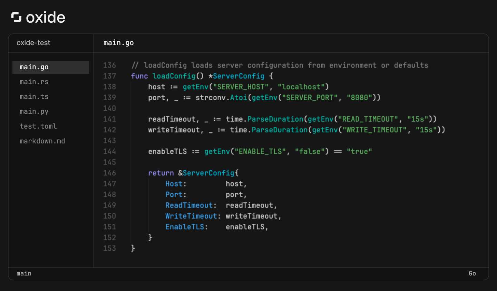
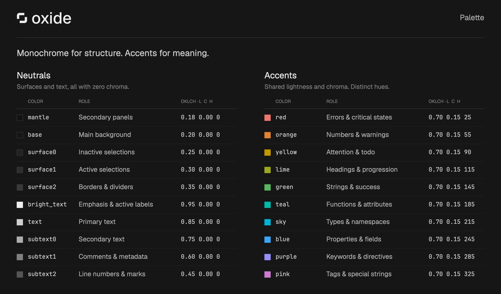

# oxide

<h6 align="center">
Where function meets form.
</h6>

  
  
  

<b>oxide</b> is a dark-only colorscheme for your editor and terminal. Deep near-black background, crisp text, and a set of accent colors that stay out of each other's way.

## Palette

**oxide** uses the OKLCH color space. Instead of eyeballing hex codes and hoping colors look balanced, OKLCH lets us set exact lightness and saturation values.

Accent colors share a target lightness of 0.70 and chroma of 0.15. Hue distinguishes their roles: red for errors, green for strings, teal for functions, and so on. Surfaces and text stay entirely monochrome.

See [colors.txt](colors.txt) for the full palette.

## Ports

Oxide is available for:

* [Neovim](https://github.com/oxidescheme/nvim)
* [Zed](https://github.com/oxidescheme/zed)
* [VS Code](https://github.com/oxidescheme/vscode)
* [Ghostty](https://github.com/oxidescheme/ghostty)
* [kitty](https://github.com/oxidescheme/kitty)
* [WezTerm](https://github.com/oxidescheme/wezterm)
* [Alacritty](https://github.com/oxidescheme/alacritty)
* [iTerm2](https://github.com/oxidescheme/iterm2)
* [Zellij](https://github.com/oxidescheme/zellij)
* [Lazygit](https://github.com/oxidescheme/lazygit)
* [Yazi](https://github.com/oxidescheme/yazi)
* [Antinote](https://github.com/oxidescheme/antinote)
* [Beeper](https://github.com/oxidescheme/beeper)
* [Web userstyles](https://github.com/oxidescheme/userstyles)

Want oxide in a tool that isn't listed? Use the [template](https://github.com/oxidescheme/template) to create a new port.

## Contributing

PRs welcome. If you're adding a port or fixing a color, make sure it matches the palette in [colors.txt](colors.txt).

For README previews, follow the [screenshot guide](https://github.com/oxidescheme/template/blob/main/TEMPLATE_GUIDE.md#screenshots).

## Acknowledgments

* **Oxocarbon**: The spiritual predecessor. oxide borrows heavily from its philosophy of uncompromising contrast.
* **Catppuccin**: For proving that a colorscheme repo can actually be organized. We borrowed their repo structure because it works.

Copyright &copy; 2025-present oxidescheme

